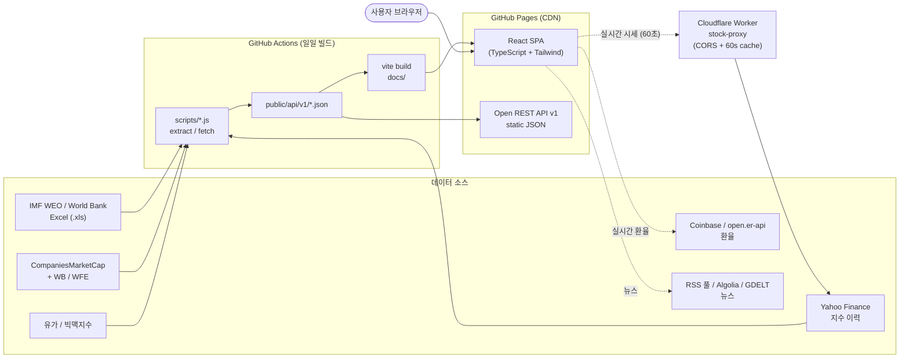

# Geonomics — 실시간 글로벌 거시경제·환율·증시 인텔리전스 대시보드

🌐 **언어 (Languages)**: [English](./README.md) | **한국어 (Korean)** | [中文 (Chinese)](./README.zh.md)

**Geonomics**는 별도의 백엔드 데이터베이스 없이 GitHub Pages 상에서 동작하는 고성능 클라이언트 사이드 글로벌 경제·금융 인텔리전스 플랫폼입니다. 전 세계 **125개국**의 공식 **IMF 세계경제전망(WEO)** 및 **세계은행(World Bank)** 거시경제 지표, 실시간 환율(160개국 이상 통화), 글로벌 주식 시가총액 히트맵, 주요 주가지수, 중앙은행 기준금리, 소매 휘발유 가격, 그리고 **이코노미스트 빅맥 지수(PPP)**를 직관적인 시각화로 제공합니다.

또한 매일 자동으로 갱신되는 **무료 오픈 정적 REST API v1 엔드포인트**를 함께 제공합니다.

---

## ✨ 주요 기능

### 1. 글로벌 경제 지도 & 거시경제 탐색기 (`GdpWorldMap`)
- **듀얼 시각화 모드**:
  - **거시경제 히트맵 (`GdpTreemap`, 기본값)**: Bruls–Huizing–van Wijk의 Squarified Treemap 알고리즘을 통해 국가별 경제 규모(총 GDP 또는 국가부채 총액)에 비례하여 면적을 분할하고, 전년 대비 증감률(YoY)에 따른 색상 스케일과 세계 점유율(%)을 표시합니다. 모바일 화면에서도 타일 크기에 맞춰 텍스트가 넘치지 않도록 반응형 타이포그래피가 적용되어 있습니다.
  - **53×28 픽셀 타일 세계지도 (`TileWorldMap`)**: **총 GDP**, **1인당 GDP**, **실질 경제성장률**, **정부부채 비율**, **물가상승률(인플레이션)**, **휘발유 가격**, **빅맥 지수(PPP)** 등 7가지 지표를 색상 스케일로 표현하며, `requestAnimationFrame` 기반의 무렌더링 플로팅 툴팁을 제공합니다.
- **대륙 다중 필터 & 롱프레스(0.7초) 단독 선택**: 5대 대륙(`아시아`, `유럽`, `아메리카`, `아프리카`, `오세아니아`)을 자유롭게 조합해 필터링하거나, 특정 대륙 버튼을 **0.7초 동안 길게 눌러** 해당 대륙만 즉시 단독 조회할 수 있습니다.
- **연도별 시점 전환**: **실적($Y-2$)**, **추정($Y-1$)**, **전망($Y$)** 연도(예: 2024 실적 / 2025 추정 / 2026 전망)를 즉시 전환할 수 있습니다.
- **반응형 정보 밀도 최적화**: 데스크톱/태블릿에서는 우측에 선택 국가 요약 HUD 사이드바를 표시하며, 모바일 화면(`< 640px`)에서는 정보 피로도를 낮추기 위해 우측 사이드바를 자동으로 숨기고 탭 시 상세 모달로 연결합니다.

### 2. 글로벌 증시 히트맵 (`StockHeatmap`)
- **약 $144조+ 규모의 글로벌 주식시장 시각화**: 전 세계 125개국의 국내 상장주식 시가총액을 Squarified Treemap으로 한눈에 비교합니다.
- **100% 자동화 실시간 시총 추정 파이프라인**: 공식 **세계은행(`CM.MKT.LCAP.CD`) / 세계거래소연맹(WFE)** 기준 시가총액에 **Yahoo Finance 실시간·히스토리컬 주가지수 변동 배율**($P_{\text{live}} / P_{\text{base}}$)과 일간 등락률(%)을 결합하여 최신 시가총액을 동적으로 산출합니다.
- **통합 뷰 & 5대륙 분할 뷰**: 글로벌 전체 통합 히트맵과 5대륙(`Americas`, `Asia`, `Europe`, `Oceania`, `Africa`) 분할 히트맵을 즉시 전환할 수 있습니다.
- **전체화면 몰입(Zen) 모드 & 글래스모피즘 HUD**: 단일 행 툴바와 전체화면 토글을 지원하며, 타일 호버 시 30일 주가 추이 스파크라인(`StockSparkline`), 현재 지수, WFE 기준치 대비 변동 배율을 플로팅 HUD로 보여줍니다.

### 3. 인터랙티브 종합 순위 테이블 (`RankingTable`)
- **카테고리 스위처**: **거시경제 지표**(총 GDP, 1인당 GDP, 경제성장률, 물가상승률, 정부부채 비율), **시장·금융 지표**(실시간 환율, 대표 주가지수 및 30일 스파크라인, 중앙은행 기준금리, 리터당 휘발유 가격, 빅맥 지수), **전체 보기**(총 12개 정렬 컬럼) 간 전환을 지원합니다.
- **플로팅 스티키 독(Floating Sticky Dock)**: 스크롤 시 검색바와 테이블 헤더가 상단 내비게이션 바 아래에 자동 고정되며, 가로 스크롤 시 순위 및 국가 컬럼이 좌측에 고정됩니다.

### 4. 1:1 국가 경제 비교 (`CompareView`)
- **양국 정밀 비교**: 주요 라이벌 프리셋(`미국 vs 중국`, `한국 vs 일본`, `독일 vs 영국`, `인도 vs 일본` 등) 또는 원하는 두 국가를 선택해 1:1로 비교합니다.
- **규모 배율 및 금리 스프레드**: 총 GDP 및 1인당 GDP 격차 배율, 양국 중앙은행 기준금리 격차(%p), 교차 환율, 빅맥 지수(PPP) 비교, 그리고 최근 10년간의 거시경제 추이 비교 차트(`GdpChart`)를 제공합니다.

### 5. 국가별 · 산업별 맞춤 경제 뉴스 탐색기 (`EconomicNewsView`)
- **3중 글로벌 외신 온디맨드 검색 엔진 (`newsApi.ts`)**: **로이터·블룸버그·CNBC·FT 외신 풀(`laapy/reuters-bloomberg-news-rss-pool`)**, **Algolia Global Story Search**, **GDELT DOC 2.0 Global News API**(비차단 타임아웃 및 쿨다운 적용)를 병렬 연동하여 전 세계 국가별·산업별 최신 기사를 실시간 수집합니다.
- **국가 × 6대 산업 테마 & 다국어 키워드 검색**: 기본값(**미국 · 금리·환율·물가**)을 비롯해 원하는 국가와 6대 테마(**경제·산업 전체**, **반도체·AI·테크**, **금리·환율·물가**, **에너지·전기차·배터리**, **무역·관세·공급망**, **증시·금융·기업**)를 조합하거나 한글·일본어·중국어·스페인어 세부 키워드(예: `반도체`, `원전`, `관세`)를 직접 입력해 글로벌 외신을 검색할 수 있습니다.
- **금융 도메인 특화 실시간 자동 번역 파이프라인**: 영문 대문자 헤드라인 정규화, 60개 이상의 월가 금융 관용구 사전(`FINANCIAL_PRE_GLOSSARY`), 금융 저널리즘 후처리 사전을 결합해 외신 제목과 요약문을 실시간 번역하며, **영문 원문 보기 / 자동 번역 보기** 즉시 전환 및 원문(EN) 호버 툴팁을 지원합니다.

### 6. 국가별 심층 분석 모달 (`CountryModal`)
- 지도 타일, 히트맵 블록, 순위 테이블 행을 클릭하면 열리며, **10개년 거시경제 추이 차트(`GdpChart`)**, **30일 대표 주가지수 차트(`StockChart`)**, **양방향 실시간 환율 계산기(`CurrencyConverter`)**, 기준금리, 유가, 빅맥 통화가치 평가 정보를 한 화면에서 제공합니다.

### 7. 8개 기준 통화 & 5개 국어 다국어(i18n) 지원
- **8개 기준 통화**: `USD ($)`, `EUR (€)`, `KRW (₩)`, `JPY (¥)`, `GBP (£)`, `CNY (¥)`, `CHF`, `AUD (A$)` 간 실시간 환산 및 언어별 단위 포맷팅(`조/억/만 원`, `兆/億/万円`, `万亿/亿/万元`, `T/B/M`)을 지원합니다.
- **5개 언어 지원**: 한국어(`ko`), 영어(`en`), 일본어(`ja`), 스페인어(`es`), 중국어(`zh`)를 지원하며, 브라우저 로케일과 시간대를 감지해 초기 언어 및 기준 통화를 자동 설정합니다(`src/utils/locale.ts`).

---

## 📡 오픈 REST API v1

Geonomics는 GitHub Pages CDN을 통해 별도의 API 키나 호출 제한 없이 누구나 사용할 수 있는 정적 JSON REST API v1을 제공합니다.

### 엔드포인트 목록

| # | 데이터셋 | 엔드포인트 (`GET`) | 설명 |
| :-: | :--- | :--- | :--- |
| **1** | **거시경제 지표** | `/api/v1/economics.json` | 125개국: 총 GDP, 1인당 GDP, 실질 성장률, 정부부채 비율, 물가상승률 및 10개년 히스토리 |
| **2** | **주요 주가지수** | `/api/v1/stocks.json` | 84개국: 대표 주가지수 티커, 현재가, 일간 등락률(%), 30일 스파크라인 포인트 |
| **3** | **국가별 주식 시가총액** | `/api/v1/stock-market-caps.json` | 125개국: 세계은행(WFE) 기준 시총 + 주가지수 연동 최신 추정 시가총액(USD) |
| **4** | **소매 휘발유 가격** | `/api/v1/fuel.json` | 170개국: 리터당 평균 소매 휘발유(RON 95) 가격(USD/L) |
| **5** | **빅맥 지수 (PPP)** | `/api/v1/bigmac.json` | 70개국+: 현지 가격, 달러 환산 가격, 통화 저/고평가율(%) 및 GDP 보정 평가율(%) |

### cURL 호출 예시

```bash
# 1. 거시경제 지표 조회 (GDP, 1인당 GDP, 성장률, 부채비율, 물가상승률)
curl -s https://silverogic.github.io/geonomics/api/v1/economics.json

# 2. 글로벌 대표 주가지수 및 30일 스파크라인 데이터
curl -s https://silverogic.github.io/geonomics/api/v1/stocks.json

# 3. 국가별 주식시장 시가총액 (WFE 기준치 + 실시간 지수 연동)
curl -s https://silverogic.github.io/geonomics/api/v1/stock-market-caps.json

# 4. 국가별 리터당 소매 휘발유 가격 (USD/L)
curl -s https://silverogic.github.io/geonomics/api/v1/fuel.json

# 5. 이코노미스트 빅맥 지수 (PPP 통화가치 평가)
curl -s https://silverogic.github.io/geonomics/api/v1/bigmac.json
```

### TypeScript / JavaScript 클라이언트 (`src/services/geonomicsApi.ts`)

```typescript
import {
  getEconomics,
  getStockPrices,
  getFuelPrices,
  getBigMacIndex,
  getAllData,
} from './services/geonomicsApi'
import { fetchStockMarketCaps } from './services/stockMarketCapApi'

// 4대 핵심 데이터셋 병렬 조회
const { economics, stocks, fuel, bigmac } = await getAllData()

// 주가지수 연동 국가별 시가총액 조회
const marketCaps = await fetchStockMarketCaps()
console.log(economics['KOR'].years['2026'].totalGdpUsd)
console.log(marketCaps.caps['KOR'])
```

---

## 🧭 시스템 개요

정적 데이터는 GitHub Actions가 미리 빌드해 GitHub Pages로 제공합니다. 브라우저는 환율과 뉴스를 직접 조회하고, 증시 실시간 시세는 작은 Cloudflare Worker 프록시를 거쳐 가져옵니다(Yahoo Finance는 CORS 때문에 브라우저 직접 호출이 불가). 프록시를 쓸 수 없으면 미리 빌드된 정적 데이터로 대체됩니다.



## 🗂️ 프로젝트 구조

```text
geonomics/
├── public/
│   ├── api/v1/                  # 오픈 REST API v1 정적 JSON 엔드포인트
│   └── data/                    # IMF / 세계은행 원본 엑셀 데이터셋 (.xls)
├── scripts/
│   ├── extractFromExcel.js      # 원본 엑셀에서 거시경제 지표를 추출하여 imfEconomic.ts 및 api/v1/economics.json 생성
│   ├── fetchStockData.js        # Yahoo Finance 30일 주가지수 데이터를 수집하여 stockPrices.ts 및 api/v1/stocks.json 갱신
│   ├── fetchStockMarketCaps.js  # WFE 시총 + 지수 변동 배율을 결합하여 api/v1/stock-market-caps.json 생성
│   ├── fetchFuelPrices.js       # 170개국 소매 휘발유 가격을 수집하여 fuelPrices.ts 및 api/v1/fuel.json 갱신
│   ├── fetchBigMacData.js       # 이코노미스트 빅맥 지수를 계산하여 bigMac.ts 및 api/v1/bigmac.json 갱신
│   └── generatePixelMap.js      # 53x28 픽셀 세계지도 타일 좌표 생성
└── src/
    ├── components/              # UI 컴포넌트 (GdpWorldMap, GdpTreemap, TileWorldMap, StockHeatmap, RankingTable, CompareView, EconomicNewsView, CountryModal, Navbar, TickerBar 등)
    ├── data/                    # 빌드 타임 동기화 데이터 및 오프라인 폴백 데이터
    ├── i18n/                    # 5개 국어 번역 사전 (en, ko, ja, es, zh)
    ├── services/                # 인메모리 TTL 캐싱이 적용된 API 서비스 (worldBankApi, exchangeApi, interestRateApi, stockMarketCapApi, newsApi, geonomicsApi)
    ├── types/                   # 핵심 TypeScript 타입 정의 (economics.ts)
    └── utils/                   # Squarified Treemap 알고리즘, 통화/숫자 포맷터, 브라우저 로케일 감지, 동적 연도 유틸리티
```

---

## 🛠️ 기술 스택

- **프론트엔드**: React 19, TypeScript 6, Vite 8
- **스타일링**: Tailwind CSS v4 (`@tailwindcss/vite`)
- **데이터 시각화**: 자체 구현 SVG Squarified Treemap 엔진, 53×28 CSS Grid 픽셀 맵, Chart.js 4 (`react-chartjs-2`)
- **아이콘 & 국기**: `lucide-react`, `country-flag-icons`
- **린터**: `oxlint`
- **데이터 파이프라인 & 배포**: Node.js ESM 수집 스크립트, `xlsx`, GitHub Actions (매일 09:00 KST 스케줄러 및 `main` 브랜치 푸시 자동 빌드·배포)

---

## 💻 로컬 실행 및 개발 가이드

### 사전 요구사항
- **Node.js**: v20 이상 (v22 권장)
- **npm**: v9 이상

### 설치 및 개발 서버 실행

```bash
# 1. 의존성 패키지 설치
npm install

# 2. 로컬 개발 서버 실행
npm run dev
```

브라우저에서 `http://localhost:5173`으로 접속하여 확인할 수 있습니다.

### 데이터 갱신 및 빌드 명령어

```bash
# IMF / 세계은행 엑셀 데이터에서 거시경제 지표 추출
npm run extract:excel

# Yahoo Finance 글로벌 대표 주가지수 수집 (74개국)
npm run fetch:stocks

# 국가별 주식 시가총액 산출 및 갱신 (WFE + 실시간 주가지수 배율)
npm run fetch:caps

# 글로벌 소매 휘발유 가격 수집 (170개국)
npm run fetch:fuel

# 이코노미스트 빅맥 지수(PPP) 데이터 갱신
npm run fetch:bigmac

# 전체 데이터 파이프라인(prebuild) 실행 후 프로덕션 빌드 생성
npm run build

# 코드 린트 검사
npm run lint
```

---

## 📊 데이터 출처

- **거시경제 통계 및 전망**: [국제통화기금 (IMF WEO)](https://www.imf.org/en/Publications/WEO) & [세계은행 오픈 데이터 (World Bank Open Data)](https://data.worldbank.org/)
- **실시간 환율**: [유럽중앙은행 (ECB)](https://www.ecb.europa.eu/) & [Open Exchange Rates API](https://open.er-api.com/)
- **주식시장 시가총액**: [세계거래소연맹 (WFE)](https://www.world-exchanges.org/) 월간 통계 & 세계은행 (`CM.MKT.LCAP.CD`)
- **주요 주가지수 시세**: Yahoo Finance & 각국 증권거래소
- **중앙은행 기준금리**: [국제결제은행 (BIS)](https://www.bis.org/) & 각국 중앙은행 공식 발표
- **소매 휘발유 가격**: [Global Petrol Prices](https://www.globalpetrolprices.com/) & 각국 에너지 당국
- **빅맥 지수 (PPP)**: [The Economist Big Mac Index](https://github.com/TheEconomist/big-mac-data)
- **국가별 · 산업별 글로벌 외신 뉴스**: [Reuters & Bloomberg RSS Pool (`laapy/reuters-bloomberg-news-rss-pool`)](https://github.com/laapy/reuters-bloomberg-news-rss-pool), [GDELT DOC 2.0 Global News API](https://www.gdeltproject.org/), & Algolia Story Search API

---

## 📄 라이선스

MIT License. 교육, 분석 및 상업적 목적으로 자유롭게 활용할 수 있습니다.
