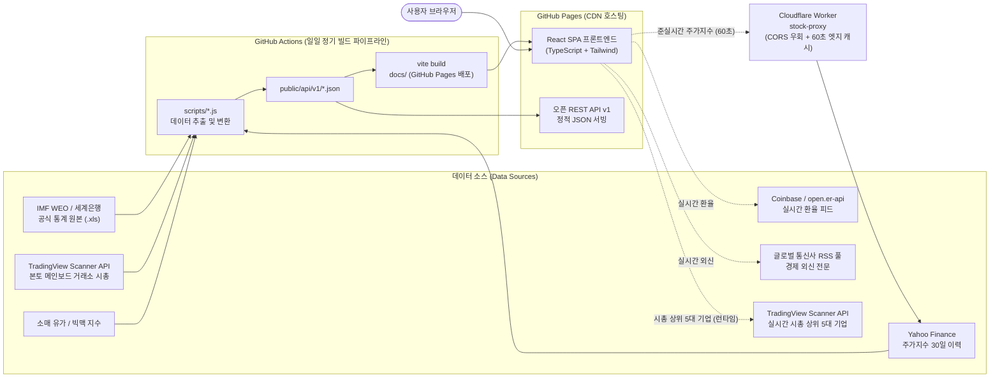

# Geonomics — 실시간 글로벌 거시경제·환율·증시 인텔리전스 대시보드

[](https://deepwiki.com/silverogic/geonomics)

**언어 (Languages)**: [English](./README.md) | **한국어 (Korean)** | [中文 (Chinese)](./README.zh.md)

**Geonomics**는 별도의 백엔드 데이터베이스 없이 GitHub Pages 상에서 동작하는 고성능 클라이언트 사이드 글로벌 경제·금융 인텔리전스 플랫폼입니다. 전 세계 **125개국**의 공식 **IMF 세계경제전망(WEO)** 및 **세계은행(World Bank)** 거시경제 지표, 실시간 환율(160개국 이상 통화), 글로벌 주식 시가총액 히트맵, 주요 주가지수, 중앙은행 기준금리, 소매 휘발유 가격, 그리고 **이코노미스트 빅맥 지수(PPP)**를 직관적인 시각화로 제공합니다.

또한 매일 자동으로 갱신되는 **무료 오픈 정적 REST API v1 엔드포인트**를 함께 제공합니다.

---

## 주요 기능

### 1. 인터랙티브 3D 경제 글로브 (`FinancialGlobeView`)
- **3대 분석 모드**:
  - **GDP 모드**: 6단계 고도화 지형 표현 및 **Top 5 앰버(Amber) 티어**(1~2위 리치 골드 `#fbbf24`, 3~5위 페일 앰버 `#fde68a`), 하단 라이브 스포트라이트 스트립, 지연 호버 시 카드가 확장되며 시각적 게이지 바와 함께 **부채 비율** 표시.
  - **증시 모드**: 대표 지수 가격 및 당일 등락률, 3D 비컨 라인, 지연 호버 시 카드가 확장되며 **30일 주가 추이 스파크라인** 표시.
  - **환율 모드**: 선택된 기준 통화 대비 실시간 환율, 지연 호버 시 카드가 확장되며 중앙은행 기관 뱃지(Fed, BOK, ECB, BOJ, PBOC 등)와 함께 **기준금리** 표시.
- **물리 인터랙션 및 조작성**:
  - **자동 회전 & 스페이스바 제어**: 부드러운 자동 회전 및 키보드 단축키(`Space`)로 즉각 일시정지/재개.
  - **대륙 퀵 점프 프리셋**: 아시아, 유럽, 미주, 오세아니아 또는 자동 회전으로 원클릭 부드러운 카메라 이동.
  - **2D 충돌 완화(Collision Relaxation)**: 지구본 회전 각도나 줌에 관계없이 공중에 떠 있는 국가 카드가 겹치지 않도록 물리적 충돌 방지.
  - **3D 극지방 이스터에그**: 북극의 3D 이글루와 남극의 펄럭이는 3D 깃발 탑재.

### 2. 글로벌 경제 지도 & 거시경제 탐색기 (`GdpWorldMap`)
- **듀얼 시각화 모드**:
  - **거시경제 히트맵 (`GdpTreemap`, 기본값)**: Bruls–Huizing–van Wijk의 Squarified Treemap 알고리즘을 통해 국가별 경제 규모(총 GDP 또는 국가부채 총액)에 비례하여 면적을 분할하고, 전년 대비 증감률(YoY)에 따른 색상 스케일과 세계 점유율(%)을 표시합니다. 모바일 화면에서도 타일 크기에 맞춰 텍스트가 넘치지 않도록 반응형 타이포그래피가 적용되어 있습니다.
  - **53×28 픽셀 타일 세계지도 (`TileWorldMap`)**: **총 GDP**, **1인당 GDP**, **실질 경제성장률**, **정부부채 비율**, **물가상승률(인플레이션)**, **휘발유 가격**, **빅맥 지수(PPP)** 등 7가지 지표를 색상 스케일로 표현하며, `requestAnimationFrame` 기반의 무렌더링 플로팅 툴팁을 제공합니다.
- **대륙 다중 필터 & 롱프레스(0.7초) 단독 선택**: 5대 대륙(`아시아`, `유럽`, `아메리카`, `아프리카`, `오세아니아`)을 자유롭게 조합해 필터링하거나, 특정 대륙 버튼을 **0.7초 동안 길게 눌러** 해당 대륙만 즉시 단독 조회할 수 있습니다.
- **연도별 시점 전환**: **실적($Y-2$)**, **추정($Y-1$)**, **전망($Y$)** 연도(예: 2024 실적 / 2025 추정 / 2026 전망)를 즉시 전환할 수 있습니다.
- **반응형 정보 밀도 최적화**: 데스크톱/태블릿에서는 우측에 선택 국가 요약 HUD 사이드바를 표시하며, 모바일 화면(`< 640px`)에서는 정보 피로도를 낮추기 위해 우측 사이드바를 자동으로 숨기고 탭 시 상세 모달로 연결합니다.

### 3. 글로벌 증시 히트맵 (`StockHeatmap`)
- **약 $144조+ 규모의 글로벌 주식시장 시각화**: 전 세계 125개국의 국내 상장주식 시가총액을 Squarified Treemap으로 한눈에 비교합니다.
- **TradingView 대표 메인보드 거래소 실측 시총 파이프라인**: 주요 72개국의 대표 정규 거래소(Mainboard: `NASDAQ/NYSE`, `KRX:KOSPI`, `SSE`, `TSE`, `TWSE`, `NSE`, `HKEX`, `LSE` 등) 주상장 보통주 시가총액을 **TradingView Global Scanner API**로 전수 합산하고(소규모 국가는 정적 기준치 폴백), 장중에는 **Yahoo Finance 실시간 지수** 변동을 반영합니다.
- **통합 뷰 & 5대륙 분할 뷰**: 글로벌 전체 통합 히트맵과 5대륙(`Americas`, `Asia`, `Europe`, `Oceania`, `Africa`) 분할 히트맵을 즉시 전환할 수 있습니다.
- **전체화면 몰입(Zen) 모드 & 글래스모피즘 HUD**: 단일 행 툴바와 전체화면 토글을 지원하며, 타일 호버 시 30일 주가 추이 스파크라인(`StockSparkline`), 현재 지수, 추정 시가총액, 그리고 **실시간 시가총액 상위 5대 기업(로고, 기업명, 시가총액, 당일 등락률 %)**을 플로팅 HUD로 보여줍니다.
- **준실시간 시세 (Cloudflare Worker 프록시)**: `VITE_STOCK_PROXY_URL`을 설정하면 장중 시세를 60초마다 갱신하며, 히트맵 툴바에 `LIVE` 뱃지, 국가 모달 주가 차트에 `LIVE` / `CLOSED` 장 상태 뱃지를 표시합니다. Yahoo Finance는 브라우저 직접 호출(CORS)을 막으므로, 작은 Worker(`workers/stock-proxy`)가 60초 엣지 캐시와 허용 도메인 제한을 두고 요청을 중계합니다. 프록시를 쓸 수 없으면 미리 빌드된 정적 데이터로 대체됩니다.

### 4. 인터랙티브 종합 순위 테이블 (`RankingTable`)
- **카테고리 스위처**: **거시경제 지표**(총 GDP, 1인당 GDP, 경제성장률, 물가상승률, 정부부채 비율), **시장·금융 지표**(실시간 환율, 대표 주가지수 및 30일 스파크라인, 중앙은행 기준금리, 리터당 휘발유 가격, 빅맥 지수), **전체 보기**(총 12개 정렬 컬럼) 간 전환을 지원합니다.
- **플로팅 스티키 독(Floating Sticky Dock)**: 스크롤 시 검색바와 테이블 헤더가 상단 내비게이션 바 아래에 자동 고정되며, 가로 스크롤 시 순위 및 국가 컬럼이 좌측에 고정됩니다.

### 5. 1:1 국가 경제 비교 (`CompareView`)
- **양국 정밀 비교**: 주요 라이벌 프리셋(`미국 vs 중국`, `한국 vs 일본`, `독일 vs 영국`, `인도 vs 일본` 등) 또는 원하는 두 국가를 선택해 1:1로 비교합니다.
- **규모 배율 및 금리 스프레드**: 총 GDP 및 1인당 GDP 격차 배율, 양국 중앙은행 기준금리 격차(%p), 교차 환율, 빅맥 지수(PPP) 비교, 그리고 최근 10년간의 거시경제 추이 비교 차트(`GdpChart`)를 제공합니다.
- **모바일 최적화 1:1 매트릭스**: 좌우 대칭 지표 매트릭스와 함께, 스크롤해도 네비게이션 바 아래에 고정되는 국가 헤더(예: "미국 vs 중국")를 제공하며, 가운데 `VS` 배지는 한 번 눌러 국가를 맞바꾸는 버튼으로도 동작합니다.
- **양국 시가총액 상위 5대 기업 맞대결 비교**: 기준 국가(A)와 비교 국가(B)의 실시간 시가총액 Top 5 대장주(공식 로고, 티커, 현지화된 산업 섹터, 선택 기준 통화 환산 시가총액, 당일 등락률 %, 100% 증시 점유율 통합 누적 가로 바)를 나란히 비교합니다.

### 6. 국가별 · 산업별 맞춤 경제 뉴스 탐색기 (`EconomicNewsView`)
- **실시간 글로벌 뉴스 집계 (`newsApi.ts`)**: **로이터·블룸버그·CNBC·FT 통신 RSS 풀**(`laapy/reuters-bloomberg-news-rss-pool`, 요약이 포함된 중복 제거된 800여 건의 전문 통신 기사)을 비차단 타임아웃 가드와 함께 수집하여 국가별·산업별 최신 기사를 제공합니다.
- **국가 × 6대 산업 테마 & 다국어 키워드 검색**: 기본값(**미국 · 금리·환율·물가**)을 비롯해 원하는 국가와 6대 테마(**경제·산업 전체**, **반도체·AI·테크**, **금리·환율·물가**, **에너지·전기차·배터리**, **무역·관세·공급망**, **증시·금융·기업**)를 조합하거나 한글·일본어·중국어·스페인어 세부 키워드(예: `반도체`, `원전`, `관세`)를 직접 입력해 글로벌 외신을 검색할 수 있습니다.
- **금융 도메인 특화 실시간 자동 번역 파이프라인**: 영문 대문자 헤드라인 정규화, 60개 이상의 월가 금융 관용구 사전(`FINANCIAL_PRE_GLOSSARY`), 금융 저널리즘 후처리 사전을 결합해 외신 제목과 요약문을 실시간 번역하며, **영문 원문 보기 / 자동 번역 보기** 즉시 전환 및 원문(EN) 호버 툴팁을 지원합니다.

### 7. 국가별 심층 분석 모달 (`CountryModal`)
- 지도 타일, 히트맵 블록, 순위 테이블 행을 클릭하면 열리며, **10개년 거시경제 추이 차트(`GdpChart`)**, **30일 대표 주가지수 차트(`StockChart`)**, **양방향 실시간 환율 계산기(`CurrencyConverter`)**, 기준금리, 유가, 빅맥 통화가치 평가 정보를 한 화면에서 제공합니다.
- **100% 동적 런타임 시가총액 상위 5대 기업 조회 (`topCompaniesApi.ts`)**: 정적 JSON 파일에 저장하지 않고 브라우저 런타임에 **TradingView Global Scanner API**를 온디맨드로 호출(2분 인메모리 캐시)하여 국가별 실시간 시가총액 Top 5 기업의 테두리 없는 공식 로고(`CompanyLogo`), 티커, 현지화 산업 섹터, 선택 통화 환산 시가총액, 당일 등락률(%), 그리고 **전체 증시(100%) 대비 점유율 통합 누적 가로 바(`TopCompaniesStackedBar`, 1~5위 + 기타 상장사)**를 표시합니다.
- **72개 본토 거래소 화이트리스트 & 대표 지수 정밀 검증**: 72개국 공식 본토 증권거래소 매핑(`COUNTRY_DOMESTIC_EXCHANGES`)과 대표 지수 편입 필터(예: 한국 `KOR`은 코스닥 `KRX:KOSDAQ`을 배제하고 코스피 `KRX:KOSPI` 상장 종목만, 미국 `USA`는 `SP:SPX`, 대만 `TWN`은 `TWSE` 본장, 중국 `CHN`은 상하이·선전 `SSE`/`SZSE` A주, 홍콩 `HKG`는 `HKEX`만 허용)를 적용하며, 정규화 기업명 기준 중복 제거로 동일 그룹 계열사(예: 삼성전자·삼성바이오로직스) 누락을 방지합니다.

### 8. 8개 기준 통화 & 현대화된 다국어(i18n) 아키텍처
- **8개 기준 통화**: `USD ($)`, `EUR (€)`, `KRW (₩)`, `JPY (¥)`, `GBP (£)`, `CNY (¥)`, `CHF`, `AUD (A$)` 간 실시간 환산 및 언어별 단위 포맷팅(`조/억/만 원`, `兆/億/万円`, `万亿/亿/万元`, `T/B/M`)을 지원합니다.
- **5개 언어 지원**: 한국어(`ko`), 영어(`en`), 일본어(`ja`), 스페인어(`es`), 중국어(`zh`)를 지원하며, 브라우저 로케일과 시간대를 감지해 초기 언어 및 기준 통화를 자동 설정합니다(`src/utils/locale.ts`).
- **표준화된 i18n 아키텍처**:
  - 업계 표준 **`i18next` & `react-i18next`** 기반의 반응형 언어 동기화.
  - 브라우저 내장 표준인 **`Intl.DisplayNames`** 및 **`Intl.RelativeTimeFormat`**을 활용하여 번들 크기 증가 없이 전 세계 모든 국가명, 통화명, 상대시간을 자동 현지화.
- **개방형 헤더 & 777 환율 슬롯 바 (`Navbar`, `TickerBar`)**: 데스크톱에서는 테두리 없는 개방형 메뉴 탭과 그라데이션 언더라인을 적용하고, 777 슬롯머신 실시간 환율 릴과 언어·통화 선택기의 높이를 `36px (h-9)`로 통일했으며, 모바일에서는 언어+기준통화 통합 팝오버 버튼(`[ KO · ₩ ▾ ]`)으로 공간 효율성을 극대화했습니다.

---

## 오픈 REST API v1

Geonomics는 GitHub Pages CDN을 통해 별도의 API 키나 호출 제한 없이 누구나 사용할 수 있는 정적 JSON REST API v1을 제공합니다.

### 엔드포인트 목록

| # | 데이터셋 | 엔드포인트 (`GET`) | 설명 |
| :-: | :--- | :--- | :--- |
| **1** | **거시경제 지표** | `/api/v1/economics.json` | 125개국: 총 GDP, 1인당 GDP, 실질 성장률, 정부부채 비율, 물가상승률 및 10개년 히스토리 |
| **2** | **주요 주가지수** | `/api/v1/stocks.json` | 84개국: 대표 주가지수 티커, 현재가, 일간 등락률(%), 30일 스파크라인 포인트 |
| **3** | **국가별 주식 시가총액** | `/api/v1/stock-market-caps.json` | 124개국: TradingView 국가별 대표 거래소(Mainboard) 상장 시가총액 합산(USD) |
| **4** | **소매 휘발유 가격** | `/api/v1/fuel.json` | 170개국: 리터당 평균 소매 휘발유(RON 95) 가격(USD/L) |
| **5** | **빅맥 지수 (PPP)** | `/api/v1/bigmac.json` | 70개국+: 현지 가격, 달러 환산 가격, 통화 저/고평가율(%) 및 GDP 보정 평가율(%) |

### cURL 호출 예시

```bash
# 1. 거시경제 지표 (총 GDP, 1인당 GDP, 경제성장률, 정부부채, 인플레이션)
curl -s https://silverogic.github.io/geonomics/api/v1/economics.json

# 2. 글로벌 주요 주가지수 & 30일 스파크라인 추이
curl -s https://silverogic.github.io/geonomics/api/v1/stocks.json

# 3. 국가별 상장주식 시가총액 (TradingView 대표 거래소 보통주 합산)
curl -s https://silverogic.github.io/geonomics/api/v1/stock-market-caps.json

# 4. 소매 휘발유 가격 (RON 95, USD/L)
curl -s https://silverogic.github.io/geonomics/api/v1/fuel.json

# 5. 이코노미스트 빅맥 지수 (PPP 통화가치 평가)
curl -s https://silverogic.github.io/geonomics/api/v1/bigmac.json
```

### TypeScript / JavaScript 클라이언트 호출 예시 (`src/services/geonomicsApi.ts`)

```typescript
import {
  getEconomics,
  getStockPrices,
  getFuelPrices,
  getBigMacIndex,
  getAllData,
} from './services/geonomicsApi'
import { fetchStockMarketCaps } from './services/stockMarketCapApi'

// 모든 핵심 데이터셋을 병렬로 한 번에 가져오기
const { economics, stocks, fuel, bigmac } = await getAllData()

// 실시간 지수와 연동된 국가별 주식 시가총액 조회
const marketCaps = await fetchStockMarketCaps()
console.log(economics['KOR'].years['2026'].totalGdpUsd)
console.log(marketCaps.caps['USA'])
```

---

## 시스템 아키텍처 개요

정적 데이터는 GitHub Actions를 통해 빌드 시점에 사전 추출되어 GitHub Pages에서 서비스됩니다. 브라우저는 추가로 실시간 환율과 외신을 직접 요청하며, Yahoo Finance 주가 지수는 CORS 제한으로 인해 작은 Cloudflare Worker 프록시를 경유하여 60초 간격으로 가져옵니다(프록시 불가 시 정적 데이터 자동 폴백).



## 프로젝트 디렉터리 구조

```text
geonomics/
├── public/
│   ├── api/v1/                  # 오픈 REST API v1 정적 JSON 엔드포인트
│   └── data/                    # IMF/세계은행 공식 원본 통계 엑셀 파일 (.xls)
├── scripts/
│   ├── extractFromExcel.js      # IMF/WB 엑셀 파일을 파싱하여 src/data/imfEconomic.ts 및 api/v1/economics.json 생성
│   ├── fetchStockData.js        # Yahoo Finance 주가지수 데이터를 수집하여 src/data/stockPrices.ts 및 api/v1/stocks.json 생성
│   ├── fetchStockMarketCaps.js  # TradingView 주요 거래소 보통주 시총을 집계하여 api/v1/stock-market-caps.json 생성
│   ├── fetchFuelPrices.js       # 소매 휘발유 가격을 갱신하여 src/data/fuelPrices.ts 및 api/v1/fuel.json 생성
│   ├── fetchBigMacData.js       # 빅맥 지수를 갱신하여 src/data/bigMac.ts 및 api/v1/bigmac.json 생성
│   └── generatePixelMap.js      # 53x28 픽셀 타일 세계지도 좌표 생성 스크립트
├── workers/
│   └── stock-proxy/             # Cloudflare Worker: 준실시간 주가 시세 중계 프록시 (CORS 우회 + 60초 캐시)
└── src/
    ├── components/              # 핵심 UI 컴포넌트 (FinancialGlobeView, GdpWorldMap, GdpTreemap, TileWorldMap, StockHeatmap, RankingTable, CompareView, EconomicNewsView, CountryModal, TopCompaniesStackedBar, CompanyLogo, Navbar, TickerBar 등)
    ├── data/                    # 정적 폴백 및 빌드 시점 동기화 데이터셋
    ├── i18n/                    # i18next 설정 및 다국어 번역 사전
    ├── services/                # 인메모리 TTL 캐시 기반 API 클라이언트 계층 (worldBankApi, exchangeApi, interestRateApi, stockMarketCapApi, topCompaniesApi, liveStockApi, newsApi, geonomicsApi)
    ├── types/                   # 핵심 TypeScript 인터페이스 및 타입 정의 (economics.ts)
    └── utils/                   # Squarified Treemap 알고리즘, 통화/숫자 포맷터, 로케일 감지 함수, 동적 연도 헬퍼
```

---

## 기술 스택

- **프론트엔드**: React 19, TypeScript 6, Vite 8
- **스타일링**: Tailwind CSS v4 (`@tailwindcss/vite`)
- **다국어화**: `i18next`, `react-i18next`, 브라우저 내장 `Intl` API
- **데이터 시각화**: 3D Canvas Voxel Engine, 자체 제작 SVG Squarified Treemap 엔진, 53×28 CSS Grid 픽셀 맵, Chart.js 4 (`react-chartjs-2`)
- **아이콘 & 국기**: `lucide-react`, `country-flag-icons`
- **린터**: `oxlint`
- **데이터 파이프라인 & CI/CD**: Node.js ESM 데이터 추출 스크립트, `xlsx`, GitHub Actions (매일 자정 자동 크론 + push 시 GitHub Pages 배포)
- **실시간 프록시**: Cloudflare Workers (`workers/stock-proxy`, 무료 티어)

---

## 로컬 개발 환경 실행 방법

### 사전 요구 사항
- **Node.js**: v20 이상 (v22 권장)
- **npm**: v9 이상

### 설치 및 로컬 서버 구동

```bash
# 1. 의존성 패키지 설치
npm install

# 2. Vite 로컬 개발 서버 실행
npm run dev
```

브라우저에서 `http://localhost:5173`으로 접속합니다.

### 준실시간 주가 프록시 설정 (선택 사항)

Cloudflare Worker를 배포하고 앱에 연결합니다:

```bash
cd workers/stock-proxy
npx wrangler login
npx wrangler deploy
```

```bash
# .env.local (로컬 개발) 및 GitHub 리포지토리 Actions Secret (프로덕션 빌드)
VITE_STOCK_PROXY_URL=https://<your-worker>.workers.dev
```

배포된 웹사이트의 도메인이 다를 경우 `workers/stock-proxy/wrangler.toml`의 `ALLOWED_ORIGINS`에 해당 도메인을 추가해야 합니다. 환경 변수를 설정하지 않으면 빌드 시점의 정적 주가 데이터로 동작합니다.

### 데이터 파이프라인 및 빌드 스크립트

```bash
# IMF/세계은행 엑셀 데이터 파싱
npm run extract:excel

# Yahoo Finance 주요국 주가지수 시세 수집
npm run fetch:stocks

# TradingView 국가별 대표 거래소 주식 시가총액 집계
npm run fetch:caps

# 소매 휘발유 가격 데이터 갱신
npm run fetch:fuel

# 빅맥 지수 데이터 갱신
npm run fetch:bigmac

# 전체 데이터 파이프라인 실행 + TypeScript 검사 + Vite 빌드
npm run build

# 코드 린트 검사
npm run lint
```

---

## 데이터 출처 및 라이선스 고지

- **거시경제 지표**: [IMF 세계경제전망 (WEO)](https://www.imf.org/en/Publications/WEO) & [세계은행 (World Bank Open Data)](https://data.worldbank.org/)
- **실시간 환율**: [유럽중앙은행 (ECB)](https://www.ecb.europa.eu/) & [Open Exchange Rates API](https://open.er-api.com/)
- **국가별 주식 시가총액 및 상위 5대 기업**: [TradingView Global Scanner API](https://www.tradingview.com/) (국가별 대표 거래소 합산)
- **대표 주가지수**: Yahoo Finance 및 각국 증권거래소 공식 시세
- **중앙은행 기준금리**: [국제결제은행 (BIS)](https://www.bis.org/) 및 각국 중앙은행
- **소매 휘발유 가격**: [Global Petrol Prices](https://www.globalpetrolprices.com/) 및 각국 에너지부
- **빅맥 지수 (PPP)**: [The Economist Big Mac Index](https://github.com/TheEconomist/big-mac-data)
- **글로벌 경제 외신 뉴스**: [Reuters & Bloomberg RSS Pool (`laapy/reuters-bloomberg-news-rss-pool`)](https://github.com/laapy/reuters-bloomberg-news-rss-pool); 헤드라인 실시간 번역은 Google Translate 웹 엔드포인트(MyMemory 백업) 기반

---

## 라이선스

MIT License. 교육, 연구, 분석 및 상업적 목적으로 자유롭게 사용하실 수 있습니다.
