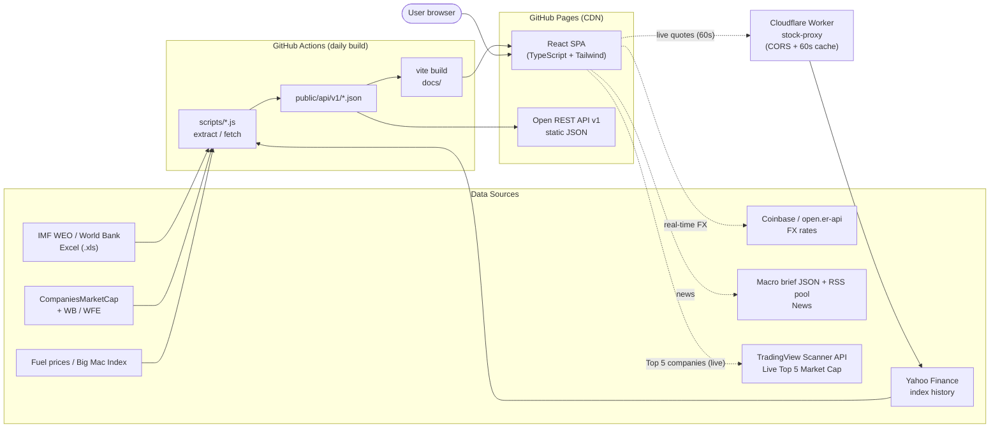

# Geonomics — Real-Time Global Macroeconomic & Financial Intelligence Dashboard

🌐 **Languages**: **English** | [한국어 (Korean)](./README.ko.md) | [中文 (Chinese)](./README.zh.md)

**Geonomics** is a serverless, client-side macroeconomic and financial market intelligence platform hosted on GitHub Pages. It synthesizes official **IMF World Economic Outlook (WEO)** and **World Bank** indicators, real-time foreign exchange rates, global equity market capitalizations, benchmark stock indices, central bank policy rates, retail gasoline prices, and **The Economist Big Mac Index (PPP)** across **125 economies**—with zero backend database overhead.

Geonomics also publishes **free, open static REST API v1 endpoints** updated automatically via daily GitHub Actions pipelines.

---

## ✨ Key Features

### 1. Global Economic Map & Macroeconomic Explorer (`GdpWorldMap`)
- **Dual Visualization Modes**:
  - **Squarified Macroeconomic Heatmap (`GdpTreemap`, Default)**: Partitions global economic scale (Total GDP or National Debt volume) proportionally using the Bruls–Huizing–van Wijk squarified treemap algorithm, color-coded by YoY growth/change rate with world share % and mobile-safe adaptive typography.
  - **53×28 Pixel Tile World Map (`TileWorldMap`)**: Interactive grid world map supporting 7 color-coded indicator modes (**Total GDP**, **GDP per Capita**, **Real Growth Rate**, **Gov Debt Ratio**, **Inflation Rate**, **Gasoline Price**, **Big Mac PPP Index**) with zero-re-render `requestAnimationFrame` floating tooltips.
- **Multi-Continent Filter & Long-Press Isolation**: Filter by any combination of continents (`Asia`, `Europe`, `Americas`, `Africa`, `Oceania`), or **long-press (0.7s)** a continent pill to isolate it immediately.
- **Multi-Horizon Time Travel**: Switch seamlessly across **Actual ($Y-2$)**, **Estimate ($Y-1$)**, and **Projection ($Y$)** horizons (e.g., 2024 Actual / 2025 Estimate / 2026 Projection).
- **Responsive UX**: Includes a live Economy Inspector HUD sidebar on desktop/tablet screens (automatically hidden on mobile `< 640px` to minimize cognitive load).

### 2. Global Stock Market Heatmap (`StockHeatmap`)
- **~$144T+ Global Equity Universe**: Visualizes domestic equity market capitalization across 125 countries using a responsive squarified treemap.
- **Hybrid Live Valuation Engine**: Combines official **World Bank (`CM.MKT.LCAP.CD`) / World Federation of Exchanges (WFE)** baseline market caps with **Yahoo Finance live index tracking** ($P_{\text{live}} / P_{\text{base}}$) and intraday percentage fluctuations.
- **Unified & 5-Continent Split Modes**: Toggle between a single global canvas and a 5-continent comparative grid (`Americas`, `Asia`, `Europe`, `Oceania`, `Africa`).
- **Zen Fullscreen Immersion & Floating Glassmorphic HUD**: Single-line control bar, one-click fullscreen mode, and hover HUD with 30-day index sparklines (`StockSparkline`), live index price, WFE base multiplier breakdown, and **live Top 5 companies by market cap** (company logo, name, market cap, and 24h change %).
- **Near-Real-Time Quotes (Cloudflare Worker Proxy)**: When `VITE_STOCK_PROXY_URL` is set, intraday quotes are refreshed every 60 seconds with a `LIVE` badge in the heatmap toolbar, and `LIVE` / `CLOSED` market-state badges in the country modal stock chart. Yahoo Finance blocks direct browser calls (CORS), so a small Worker (`workers/stock-proxy`) relays requests with a 60s edge cache and an origin allow-list. If the proxy is unavailable, the app falls back to the prebuilt static data.

### 3. Interactive Ranking Table (`RankingTable`)
- **Category Switcher**: Filter columns by **Macroeconomic** (Total GDP, GDP per Capita, Real Growth, Inflation, Gov Debt), **Market & Finance** (FX Rate, Stock Index & 30D Sparkline, Central Bank Policy Rate, Retail Fuel Price, Big Mac Index), or **All Metrics** (12 sortable columns).
- **Floating Sticky Dock**: Automatically docks the search bar and table headers below the navbar while scrolling, with frozen sticky rank and country columns on horizontal scroll.

### 4. 1:1 Economy Comparison (`CompareView`)
- **Side-by-Side Benchmarking**: Compare any two countries with one-click rivalry presets (`USA vs CHN`, `KOR vs JPN`, `DEU vs GBR`, `IND vs JPN`, etc.).
- **Scale Multiples & Spreads**: Automatically computes GDP scale multiples, GDP per capita ratios, central bank interest rate spreads, bilateral FX cross-rates, Big Mac PPP valuations, and dual 10-year historical trajectory charts (`GdpChart`).
- **Mobile-Optimized Head-to-Head Matrix**: A symmetric 1:1 metric matrix with a sticky country header (e.g. "USA vs CHN") that stays pinned under the navbar while scrolling; the `VS` badge doubles as a one-tap swap button.
- **Side-by-Side Top 5 Market Cap Companies Comparison**: Directly compares the Top 5 flagship companies of Country A and Country B (with official logos, tickers, localized sectors, live market caps in the selected base currency, 24h change %, and 100% national market share stacked bars).

### 5. Country & Sector Customized Economic News (`EconomicNewsView`)
- **Two-Source Global News Aggregation (`newsApi.ts`)**: Combines a live **Macro Brief feed** (`givanchris/News` `brief.json`: macro, central banks, commodities, markets, trade, etc.) with the **Reuters/Bloomberg/CNBC/FT Wire RSS Pool** (`laapy/reuters-bloomberg-news-rss-pool`, 800+ deduplicated wire articles with summaries), with non-blocking timeout guards.
- **Country × Sector & Custom Keyword Search**: Explore targeted economic articles for any country across **6 industry/macro themes** (**All Economy & Business**, **Semiconductors & AI**, **Rates, FX & Inflation**, **Energy, EV & Battery**, **Trade, Tariffs & Supply Chain**, **Stocks & Corporate**) or type custom keywords in any supported language (automatically translated to English for global querying).
- **Financial Domain Real-Time Translation Pipeline**: Translates English wire headlines and summaries on-the-fly into Korean, Japanese, Spanish, and Chinese using ALL-CAPS headline normalization, a 60+ Wall Street idiom pre-glossary, and natural financial terminology post-processing, with instant **View Original (EN) / Auto-Translate** toggling and original English hover tooltips.

### 6. Country Deep-Dive Modal (`CountryModal`)
- **All-in-One Country Profile**: Displays 10-year historical macroeconomic trajectory charts (`GdpChart`), 30-day stock index performance charts (`StockChart`), an interactive two-way **Currency Converter (`CurrencyConverter`)**, central bank policy rate, fuel price, and Big Mac PPP valuation.
- **100% Dynamic Runtime Top 5 Companies by Market Cap (`topCompaniesApi.ts`)**: Queries the **TradingView Global Scanner API** on-demand at runtime (zero static JSON storage, 2-minute in-memory TTL cache) to display each country's live Top 5 companies with borderless official SVG logos (`CompanyLogo`), tickers, localized industry sectors, live market cap in `baseCurrency`, 24h price change %, and a **Unified 100% Market Share Stacked Bar (`TopCompaniesStackedBar`)** visualizing Top 1–5 concentration vs. the rest of the market.
- **Strict 72-Exchange & Benchmark Index Verification**: Enforces a 72-country domestic exchange whitelist (`COUNTRY_DOMESTIC_EXCHANGES`) and index membership rules (e.g. strictly `KRX:KOSPI` excluding `KOSDAQ` for South Korea, `SP:SPX` for the US, `TWSE` main board for Taiwan, `SSE`/`SZSE` A-shares for mainland China, `HKEX` for Hong Kong) while deduplicating dual-class shares by normalized company name so conglomerate affiliates (e.g. Samsung Electronics vs. Samsung Biologics) are accurately preserved.

### 7. Multi-Currency & 5-Language Localization (i18n)
- **8 Base Currencies**: `USD ($)`, `EUR (€)`, `KRW (₩)`, `JPY (¥)`, `GBP (£)`, `CNY (¥)`, `CHF`, and `AUD (A$)` with native unit formatting (`조/억/만 원`, `兆/億/万円`, `万亿/亿/万元`, `T/B/M`).
- **5 Languages**: English (`en`), Korean (`ko`), Japanese (`ja`), Spanish (`es`), and Chinese (`zh`), with automatic browser locale and regional currency detection (`src/utils/locale.ts`).
- **Streamlined Header & 777 FX Slot Reel (`Navbar`, `TickerBar`)**: Features a borderless open desktop navigation bar with gradient active indicators, unified 36px (`h-9`) control height across the localized 777 slot-machine FX reel and selectors, and a unified mobile language + currency quick-switch popover (`[ 🇰🇷 KO · ₩ ▾ ]`).

---

## 📡 Open REST API v1

Geonomics serves static JSON REST API v1 endpoints via GitHub Pages CDN. No API keys or authentication required.

### Endpoints Overview

| # | Dataset | Endpoint (`GET`) | Description |
| :-: | :--- | :--- | :--- |
| **1** | **Macroeconomic Indicators** | `/api/v1/economics.json` | 125 economies: Total GDP, GDP per capita, real growth, gov debt %, inflation % & 10Y history |
| **2** | **Stock Benchmark Indices** | `/api/v1/stocks.json` | 84 economies: Flagship index ticker, current price, 24h change %, and 30-day sparkline points |
| **3** | **Stock Market Capitalization** | `/api/v1/stock-market-caps.json` | 125 economies: Official WFE / World Bank baseline cap + live index multiplier 2026 est. (USD) |
| **4** | **Retail Gasoline Prices** | `/api/v1/fuel.json` | 170 economies: National average RON 95 retail gasoline price in USD/L |
| **5** | **Big Mac Index (PPP)** | `/api/v1/bigmac.json` | 70+ economies: Local price, dollar price, raw PPP valuation %, and GDP-adjusted valuation % |

### cURL Examples

```bash
# 1. Macroeconomic indicators (GDP, per capita, growth, debt, inflation)
curl -s https://silverogic.github.io/geonomics/api/v1/economics.json

# 2. Global stock benchmark indices & 30-day sparklines
curl -s https://silverogic.github.io/geonomics/api/v1/stocks.json

# 3. National stock market capitalization (WFE baseline + live index tracking)
curl -s https://silverogic.github.io/geonomics/api/v1/stock-market-caps.json

# 4. Retail gasoline prices (RON 95, USD/L)
curl -s https://silverogic.github.io/geonomics/api/v1/fuel.json

# 5. The Economist Big Mac Index (PPP valuation)
curl -s https://silverogic.github.io/geonomics/api/v1/bigmac.json
```

### TypeScript / JavaScript Client (`src/services/geonomicsApi.ts`)

```typescript
import {
  getEconomics,
  getStockPrices,
  getFuelPrices,
  getBigMacIndex,
  getAllData,
} from './services/geonomicsApi'
import { fetchStockMarketCaps } from './services/stockMarketCapApi'

// Fetch all core datasets in parallel
const { economics, stocks, fuel, bigmac } = await getAllData()

// Fetch live-indexed stock market capitalizations
const marketCaps = await fetchStockMarketCaps()
console.log(economics['KOR'].years['2026'].totalGdpUsd)
console.log(marketCaps.caps['USA'])
```

---

## 🧭 System Overview

Static data is prebuilt by GitHub Actions and served from GitHub Pages. The browser additionally pulls live FX rates and news directly, and near-real-time stock quotes through a small Cloudflare Worker proxy (Yahoo Finance does not allow direct browser calls due to CORS). If the proxy is unavailable, the app falls back to the prebuilt static data.



## 🗂️ Project Architecture

```text
geonomics/
├── public/
│   ├── api/v1/                  # Open REST API v1 static JSON endpoints
│   └── data/                    # Official IMF/World Bank source Excel datasets (.xls)
├── scripts/
│   ├── extractFromExcel.js      # Extracts IMF/WB Excel workbooks into src/data/imfEconomic.ts & api/v1/economics.json
│   ├── fetchStockData.js        # Fetches Yahoo Finance 30D index history into src/data/stockPrices.ts & api/v1/stocks.json
│   ├── fetchStockMarketCaps.js  # Computes WFE + live index market caps into api/v1/stock-market-caps.json
│   ├── fetchFuelPrices.js       # Updates retail gasoline prices into src/data/fuelPrices.ts & api/v1/fuel.json
│   ├── fetchBigMacData.js       # Updates Big Mac PPP dataset into src/data/bigMac.ts & api/v1/bigmac.json
│   └── generatePixelMap.js      # Generates 53x28 pixel world map coordinates
├── workers/
│   └── stock-proxy/             # Cloudflare Worker: near-real-time stock quote proxy (CORS + 60s cache)
└── src/
    ├── components/              # UI Components (GdpWorldMap, GdpTreemap, TileWorldMap, StockHeatmap, RankingTable, CompareView, EconomicNewsView, CountryModal, TopCompaniesStackedBar, CompanyLogo, Navbar, TickerBar, etc.)
    ├── data/                    # Typed fallback & build-time synchronized datasets
    ├── i18n/                    # 5-language translation dictionary (en, ko, ja, es, zh)
    ├── services/                # API clients with in-memory TTL caching (worldBankApi, exchangeApi, interestRateApi, stockMarketCapApi, topCompaniesApi, liveStockApi, newsApi, geonomicsApi)
    ├── types/                   # Core TypeScript interfaces (economics.ts)
    └── utils/                   # Squarified treemap layout, currency/number formatters, locale detection, dynamic year helpers
```

---

## 🛠️ Tech Stack

- **Frontend**: React 19, TypeScript 6, Vite 8
- **Styling**: Tailwind CSS v4 (`@tailwindcss/vite`)
- **Data Visualization**: Custom SVG Squarified Treemap Engine, 53×28 CSS Grid Pixel Map, Chart.js 4 (`react-chartjs-2`)
- **Icons & Flags**: `lucide-react`, `country-flag-icons`
- **Linter**: `oxlint`
- **Data Pipeline & CI/CD**: Node.js ESM data extractors, `xlsx`, GitHub Actions (daily cron + push deployment to GitHub Pages)
- **Live Quote Proxy**: Cloudflare Workers (`workers/stock-proxy`, free tier)

---

## 💻 Getting Started Locally

### Prerequisites
- **Node.js**: v20+ (v22 recommended)
- **npm**: v9+

### Installation & Development

```bash
# 1. Install dependencies
npm install

# 2. Start local Vite development server
npm run dev
```

Open `http://localhost:5173` in your browser.

### Near-Real-Time Stock Quotes (Optional)

Deploy the proxy once, then point the app at it:

```bash
cd workers/stock-proxy
npx wrangler login
npx wrangler deploy
```

```bash
# .env.local (local dev) and GitHub repo Actions Variable (production build)
VITE_STOCK_PROXY_URL=https://<your-worker>.workers.dev
```

Edit `ALLOWED_ORIGINS` in `workers/stock-proxy/wrangler.toml` if the site is served from a different origin. Without the variable, only prebuilt static stock data is used.

### Data Pipeline & Build Scripts

```bash
# Extract macroeconomic metrics from IMF/World Bank Excel files
npm run extract:excel

# Fetch latest Yahoo Finance benchmark stock indices (74 countries)
npm run fetch:stocks

# Fetch latest national stock market capitalizations (WFE + Yahoo Finance multiplier)
npm run fetch:caps

# Fetch latest retail gasoline prices (170 countries)
npm run fetch:fuel

# Fetch latest Big Mac PPP index data
npm run fetch:bigmac

# Run all data pipelines + TypeScript check + Vite production build
npm run build

# Run linter
npm run lint
```

---

## 📊 Data Sources & Attribution

- **Macroeconomic Indicators**: [IMF World Economic Outlook (WEO)](https://www.imf.org/en/Publications/WEO) & [World Bank Open Data](https://data.worldbank.org/)
- **Foreign Exchange Rates**: [European Central Bank (ECB)](https://www.ecb.europa.eu/) & [Open Exchange Rates API](https://open.er-api.com/)
- **Stock Market Capitalization**: [World Federation of Exchanges (WFE)](https://www.world-exchanges.org/) & World Bank (`CM.MKT.LCAP.CD`)
- **Stock Benchmark Indices**: Yahoo Finance & National Stock Exchanges
- **Central Bank Policy Rates**: [Bank for International Settlements (BIS)](https://www.bis.org/) & National Central Banks
- **Retail Gasoline Prices**: [Global Petrol Prices](https://www.globalpetrolprices.com/) & National Energy Ministries
- **Big Mac Index (PPP)**: [The Economist Big Mac Index](https://github.com/TheEconomist/big-mac-data)
- **Global Economic & Sector News**: [Reuters & Bloomberg RSS Pool (`laapy/reuters-bloomberg-news-rss-pool`)](https://github.com/laapy/reuters-bloomberg-news-rss-pool) & Macro Brief feed ([`givanchris/News`](https://github.com/givanchris/News)); headline translation via Google Translate web endpoint with MyMemory fallback

---

## 📄 License

MIT License. Free for educational, analytical, and commercial use.
