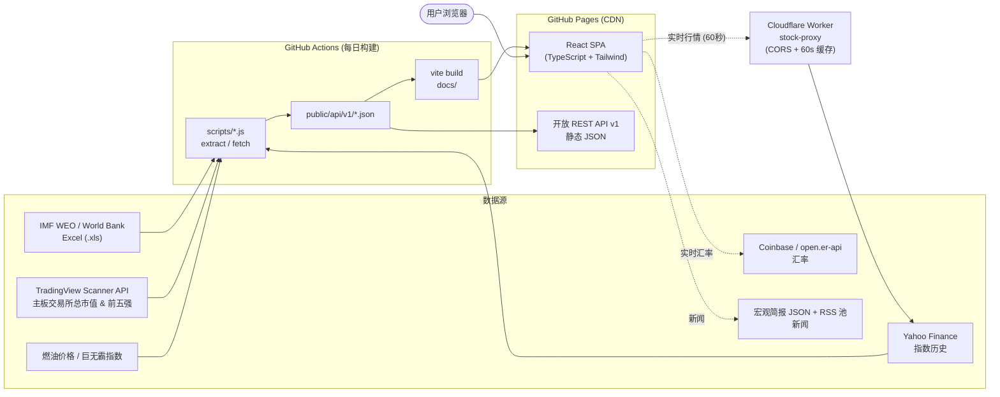

# Geonomics — 实时全球宏观经济与金融情报仪表盘

🌐 **语言**: [English](./README.md) | [한국어 (Korean)](./README.ko.md) | **中文**

**Geonomics** 是一个托管在 GitHub Pages 上的无服务器（serverless）、纯客户端宏观经济与金融市场情报平台。它整合了 **IMF 世界经济展望（WEO）** 与 **世界银行** 官方指标、实时汇率、全球股市市值、基准股指、央行政策利率、零售汽油价格以及 **《经济学人》巨无霸指数（PPP）**，覆盖 **125 个经济体**——无需任何后端数据库。

Geonomics 还提供**免费开放的静态 REST API v1 接口**，通过每日 GitHub Actions 流水线自动更新。

---

## ✨ 主要功能

### 1. 全球经济地图与宏观经济浏览器（`GdpWorldMap`）
- **两种可视化模式**：
  - **Squarified 宏观经济热力图（`GdpTreemap`，默认）**：使用 Bruls–Huizing–van Wijk squarified treemap 算法，按比例划分全球经济规模（GDP 总量或政府债务规模），以同比增速/变化率着色，并显示世界占比（%）及适配移动端的自适应字体。
  - **53×28 像素块世界地图（`TileWorldMap`）**：交互式网格世界地图，支持 7 种配色指标模式（**GDP 总量**、**人均 GDP**、**实际增长率**、**政府债务比率**、**通胀率**、**汽油价格**、**巨无霸 PPP 指数**），悬浮提示框基于 `requestAnimationFrame`，无需重新渲染。
- **多大洲筛选与长按隔离**：可任意组合大洲（`Asia`、`Europe`、`Americas`、`Africa`、`Oceania`）进行筛选，或**长按（0.7 秒）**某个大洲标签以立即单独显示。
- **多时间维度穿梭**：可在**实际值（$Y-2$）**、**估计值（$Y-1$）**、**预测值（$Y$）**之间无缝切换（例如 2024 实际 / 2025 估计 / 2026 预测）。
- **响应式体验**：桌面/平板端提供实时经济检查器 HUD 侧边栏（在移动端 `< 640px` 自动隐藏，以降低认知负担）。

### 2. 全球股市热力图（`StockHeatmap`）
- **约 144 万亿美元以上的全球股市规模**：使用响应式 squarified treemap，可视化 125 个国家的本国股市市值。
- **TradingView 代表性主板交易所实测市值引擎**：通过 **TradingView Global Scanner API** 汇总全球 72 个主要国家代表性主板交易所（`NASDAQ/NYSE`、`SSE`、`TSE`、`NSE`、`TWSE`、`KRX:KOSPI`、`HKEX` 等）上市普通股总市值（小型经济体采用精选基准值），并结合 **Yahoo Finance 实时指数行情**动态更新。
- **统一视图与五大洲分栏模式**：可在单一全球画布与五大洲对比网格（`Americas`、`Asia`、`Europe`、`Oceania`、`Africa`）之间切换。
- **Zen 全屏沉浸与悬浮毛玻璃 HUD**：单行控制栏、一键全屏模式，悬停 HUD 显示 30 日指数迷你图（`StockSparkline`）、实时指数价格、最新总市值及**实时市值前五强企业（企业图标、名称、市值、日涨跌幅 %）**。
- **近实时行情（Cloudflare Worker 代理）**：当配置 `VITE_STOCK_PROXY_URL` 时，每 60 秒拉取一次盘中报价，并显示 `LIVE` 标识；代理不可用时自动回退到预构建的静态数据。

### 3. 交互式排名表（`RankingTable`）
- **类别切换**：可按**宏观经济**（GDP 总量、人均 GDP、实际增长、通胀、政府债务）、**市场与金融**（汇率、股指及 30 日迷你图、央行政策利率、零售燃油价格、巨无霸指数）或**全部指标**（12 个可排序列）筛选列。
- **浮动吸顶 Dock**：滚动时自动将搜索栏和表头吸附在导航栏下方，横向滚动时冻结排名和国家列。

### 4. 一对一经济体对比（`CompareView`）
- **并排基准对比**：一键切换对抗预设（`USA vs CHN`、`KOR vs JPN`、`DEU vs GBR`、`IND vs JPN` 等），任意两国均可对比。
- **规模倍数与利差**：自动计算 GDP 规模倍数、人均 GDP 比率、央行利率差、双边汇率交叉汇率、巨无霸 PPP 估值，以及双 10 年历史走势图（`GdpChart`）。
- **移动端优化**：提供 1:1 对称矩阵视图，滚动时国家对比头部（如“美国 vs 中国”）吸顶显示。
- **两国市值前五强企业并排对比**：直接对比两国市值前五强龙头企业（官方图标、代码、本地化行业分类、按所选基准货币折算的实时市值、24 小时涨跌幅 %，以及 100% 股市占比堆叠横条）。

### 5. 国家与行业定制经济新闻（`EconomicNewsView`）
- **双源全球新闻聚合（`newsApi.ts`）**：结合实时**宏观简报源**（`givanchris/News` 的 `brief.json`：宏观、央行、大宗商品、市场、贸易等）与**路透/彭博/CNBC/FT 通讯社 RSS 池**（`laapy/reuters-bloomberg-news-rss-pool`，800 多篇带摘要的去重通讯稿），并带有非阻塞超时保护。
- **国家 × 行业与自定义关键词搜索**：可针对任意国家，在 **6 大行业/宏观主题**（**经济与商业综合**、**半导体与 AI**、**利率、汇率与通胀**、**能源、电动车与电池**、**贸易、关税与供应链**、**股票与企业**）下浏览定向经济文章，或以任意受支持语言输入自定义关键词（自动翻译为英文进行全球查询）。
- **金融领域实时翻译管线**：通过全大写标题规范化、60 多条华尔街习语预词表以及自然的金融术语后处理，将英文通讯稿标题与摘要即时翻译为韩语、日语、西班牙语和中文，并支持**查看原文（EN）/ 自动翻译**即时切换及英文原文悬停提示。

### 6. 国家深度详情弹窗（`CountryModal`）
- **一站式国家档案**：展示 10 年历史宏观经济走势图（`GdpChart`）、30 日股指表现图（`StockChart`，含 `LIVE`/`CLOSED` 状态标识）、交互式双向**货币转换器（`CurrencyConverter`）**、央行政策利率、燃油价格以及巨无霸 PPP 估值。
- **100% 动态运行时市值前五强企业查询（`topCompaniesApi.ts`）**：零静态 JSON 存储，浏览器运行时按需直连 **TradingView Global Scanner API**（2 分钟内存缓存），展示无边框官方企业图标（`CompanyLogo`）、股票代码、本地化行业、实时市值、日涨跌幅 %，以及**占本国股市 100% 堆叠横条（`TopCompaniesStackedBar`，前 1–5 强 + 其他上市企业）**。
- **72 个本土交易所白名单与基准指数校验**：内置 72 国本土证券交易所映射（`COUNTRY_DOMESTIC_EXCHANGES`）与指数成分校验（例如韩国 `KOR` 严格限定 `KRX:KOSPI` 并排除 `KOSDAQ`，美国 `USA` 校验 `SP:SPX`，中国大陆 `CHN` 限定 `SSE`/`SZSE` A 股，中国香港 `HKG` 限定 `HKEX`，中国台湾 `TWN` 限定 `TWSE` 主板），并按规范化公司名称去重以完整保留同集团独立上市子公司（如三星电子与三星生物制剂）。

### 7. 多币种与五语言本地化（i18n）
- **8 种基准货币**：`USD ($)`、`EUR (€)`、`KRW (₩)`、`JPY (¥)`、`GBP (£)`、`CNY (¥)`、`CHF` 和 `AUD (A$)`，采用本地单位格式（`조/억/만`、`兆/億/万円`、`万亿/亿/万元`、`T/B/M`）。
- **5 种语言**：英语（`en`）、韩语（`ko`）、日语（`ja`）、西班牙语（`es`）和中文（`zh`），自动检测浏览器语言与地区货币（`src/utils/locale.ts`）。

---

## 📡 开放 REST API v1

Geonomics 通过 GitHub Pages CDN 提供静态 JSON REST API v1 接口，无需 API 密钥或身份验证。

### 接口概览

| # | 数据集 | 接口（`GET`） | 说明 |
| :-: | :--- | :--- | :--- |
| **1** | **宏观经济指标** | `/api/v1/economics.json` | 125 个经济体：GDP 总量、人均 GDP、实际增长、政府债务占比、通胀率及 10 年历史 |
| **2** | **基准股指** | `/api/v1/stocks.json` | 84 个经济体：旗舰指数代码、当前价格、日涨跌幅及 30 日迷你图数据点 |
| **3** | **股市市值** | `/api/v1/stock-market-caps.json` | 124 个经济体：TradingView 各国代表性主板交易所汇总市值（USD） |
| **4** | **零售汽油价格** | `/api/v1/fuel.json` | 170 个经济体：全国平均 RON 95 零售汽油价格（美元/升） |
| **5** | **巨无霸指数（PPP）** | `/api/v1/bigmac.json` | 70+ 个经济体：本地价格、美元价格、原始 PPP 估值 % 及 GDP 调整后估值 % |

### cURL 示例

```bash
# 1. 宏观经济指标（GDP、人均、增长、债务、通胀）
curl -s https://silverogic.github.io/geonomics/api/v1/economics.json

# 2. 全球基准股指与 30 日迷你图
curl -s https://silverogic.github.io/geonomics/api/v1/stocks.json

# 3. 各国股市市值（TradingView 代表性主板交易所市值汇总）
curl -s https://silverogic.github.io/geonomics/api/v1/stock-market-caps.json

# 4. 零售汽油价格（RON 95，美元/升）
curl -s https://silverogic.github.io/geonomics/api/v1/fuel.json

# 5. 《经济学人》巨无霸指数（PPP 估值）
curl -s https://silverogic.github.io/geonomics/api/v1/bigmac.json
```

### TypeScript / JavaScript 客户端（`src/services/geonomicsApi.ts`）

```typescript
import {
  getEconomics,
  getStockPrices,
  getFuelPrices,
  getBigMacIndex,
  getAllData,
} from './services/geonomicsApi'
import { fetchStockMarketCaps } from './services/stockMarketCapApi'

// 并行获取所有核心数据集
const { economics, stocks, fuel, bigmac } = await getAllData()

// 获取实时指数联动的股市市值
const marketCaps = await fetchStockMarketCaps()
console.log(economics['KOR'].years['2026'].totalGdpUsd)
console.log(marketCaps.caps['USA'])
```

---

## 🧭 系统概览

静态数据由 GitHub Actions 预先构建，并通过 GitHub Pages 提供。浏览器会直接获取实时汇率和新闻，近实时股票行情则通过一个小型 Cloudflare Worker 代理获取（Yahoo Finance 因 CORS 限制不允许浏览器直接调用）。如果代理不可用，应用会回退到预构建的静态数据。



## 🗂️ 项目结构

```text
geonomics/
├── public/
│   ├── api/v1/                  # 开放 REST API v1 静态 JSON 接口
│   └── data/                    # IMF/世界银行官方来源 Excel 数据集 (.xls)
├── scripts/
│   ├── extractFromExcel.js      # 将 IMF/WB Excel 工作簿提取为 src/data/imfEconomic.ts 和 api/v1/economics.json
│   ├── fetchStockData.js        # 获取 Yahoo Finance 30 日指数历史并写入 src/data/stockPrices.ts 和 api/v1/stocks.json
│   ├── fetchStockMarketCaps.js  # 汇总 TradingView 代表性主板交易所市值并写入 api/v1/stock-market-caps.json
│   ├── fetchFuelPrices.js       # 更新零售汽油价格至 src/data/fuelPrices.ts 和 api/v1/fuel.json
│   ├── fetchBigMacData.js       # 更新巨无霸 PPP 数据集至 src/data/bigMac.ts 和 api/v1/bigmac.json
│   └── generatePixelMap.js      # 生成 53x28 像素世界地图坐标
├── workers/
│   └── stock-proxy/             # Cloudflare Worker：近实时股票行情代理（CORS + 60 秒缓存）
└── src/
    ├── components/              # UI 组件（GdpWorldMap、GdpTreemap、TileWorldMap、StockHeatmap、RankingTable、CompareView、EconomicNewsView、CountryModal、TopCompaniesStackedBar、CompanyLogo、Navbar、TickerBar 等）
    ├── data/                    # 带类型的回退数据与构建时同步数据集
    ├── i18n/                    # 5 语言翻译词典 (en, ko, ja, es, zh)
    ├── services/                # 带内存 TTL 缓存的 API 客户端（worldBankApi、exchangeApi、interestRateApi、stockMarketCapApi、topCompaniesApi、liveStockApi、newsApi、geonomicsApi）
    ├── types/                   # 核心 TypeScript 接口 (economics.ts)
    └── utils/                   # Squarified treemap 布局、货币/数字格式化、语言检测、动态年份工具
```

---

## 🛠️ 技术栈

- **前端**：React 19、TypeScript 6、Vite 8
- **样式**：Tailwind CSS v4（`@tailwindcss/vite`）
- **数据可视化**：自定义 SVG Squarified Treemap 引擎、53×28 CSS Grid 像素地图、Chart.js 4（`react-chartjs-2`）
- **图标与旗帜**：`lucide-react`、`country-flag-icons`
- **代码检查**：`oxlint`
- **数据管线与 CI/CD**：Node.js ESM 数据提取器、`xlsx`、GitHub Actions（每日定时任务 + 推送部署到 GitHub Pages）
- **实时行情代理**：Cloudflare Workers（`workers/stock-proxy`）

---

## 💻 本地运行与开发指南

### 前置条件
- **Node.js**：v20+（推荐 v22）
- **npm**：v9+

### 安装与开发

```bash
# 1. 安装依赖
npm install

# 2. 启动本地 Vite 开发服务器
npm run dev
```

在浏览器中打开 `http://localhost:5173`。

### 近实时股票行情（可选）

部署 `workers/stock-proxy`（`npx wrangler deploy`）后，在 `.env.local` 中设置代理地址：

```bash
VITE_STOCK_PROXY_URL=https://<your-worker>.workers.dev
```

未设置时，应用仅使用预构建的静态股票数据。

### 数据管线与构建脚本

```bash
# 从 IMF/世界银行 Excel 文件中提取宏观经济指标
npm run extract:excel

# 获取最新 Yahoo Finance 基准股指（74 个国家）
npm run fetch:stocks

# 获取最新各国股市市值（TradingView 代表性主板交易所汇总）
npm run fetch:caps

# 获取最新零售汽油价格（170 个国家）
npm run fetch:fuel

# 获取最新巨无霸 PPP 指数数据
npm run fetch:bigmac

# 运行全部数据管线 + TypeScript 检查 + Vite 生产构建
npm run build

# 运行代码检查
npm run lint
```

---

## 📊 数据来源与致谢

- **宏观经济指标**：[IMF 世界经济展望（WEO）](https://www.imf.org/en/Publications/WEO) 与 [世界银行开放数据](https://data.worldbank.org/)
- **外汇汇率**：[欧洲央行（ECB）](https://www.ecb.europa.eu/) 与 [Open Exchange Rates API](https://open.er-api.com/)
- **股市市值与前五强企业**：[TradingView Global Scanner API](https://www.tradingview.com/)（各国代表性主板交易所上市普通股汇总）
- **基准股指**：Yahoo Finance 与各国证券交易所
- **央行政策利率**：[国际清算银行（BIS）](https://www.bis.org/) 与各国央行
- **零售汽油价格**：[Global Petrol Prices](https://www.globalpetrolprices.com/) 与各国能源部门
- **巨无霸指数（PPP）**：[《经济学人》巨无霸指数](https://github.com/TheEconomist/big-mac-data)
- **全球经济与行业新闻**：[路透与彭博 RSS 池（`laapy/reuters-bloomberg-news-rss-pool`）](https://github.com/laapy/reuters-bloomberg-news-rss-pool) 与宏观简报源（[`givanchris/News`](https://github.com/givanchris/News)）；标题翻译使用 Google Translate 网页端点（MyMemory 作为备用）

---

## 📄 许可证

MIT 许可证。可免费用于教育、分析和商业用途。
